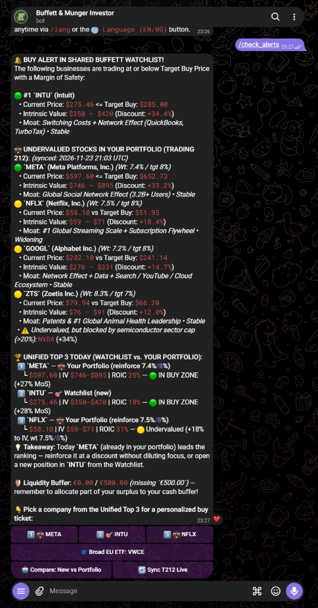
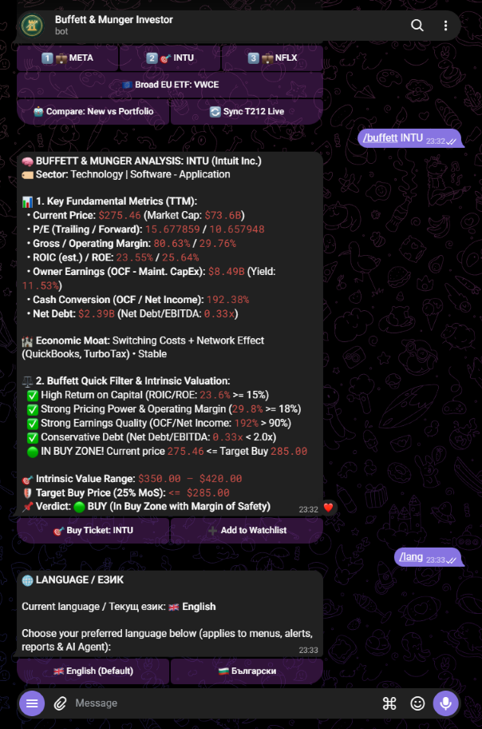

# 🏰 Buffett & Munger Investor Bot

**Multi-user value investing Telegram bot powered by Warren Buffett & Charlie Munger's investment framework.**  
Live Owner Earnings valuation • Trading 212 portfolio sync • Unified Top-3 ranker • Automated buy-zone alerts • Built-in Gemini AI agent.

---

## 🎯 What Is This Bot?

Most retail investing tools drown you in noisy charts, hype, and short-term price swings (*Mr. Market*).  
**Buffett & Munger Investor Bot** brings disciplined, long-term **value investing** directly into Telegram — with zero spreadsheets and zero hardcoded stock picks:

- **Know what to buy today:** Compares every undervalued stock you **already own** in Trading 212 head-to-head against a **shared Buffett Watchlist** and ranks today's **Unified Top 3** opportunities.
- **Protect your downside first (Charlie Munger's Inversion):** Tracks high-interest debt (>10–12% APR), reminds you to build a cash emergency buffer so you are never forced to sell great businesses, and automatically enforces sector-concentration caps (>20–25% in a single risky sector such as semiconductors).
- **100% Private per User + Shared Community Watchlist:** Every user gets an isolated profile with AES-128 encrypted Read-Only Trading 212 keys, private budget, cash buffer, payday schedule, and optional loans — while everyone shares one synchronized Buffett Watchlist.

---

## 📱 Live Screenshots (Telegram Dark Mode)

<table>
  <tr>
    <td align="center" width="50%">
      <strong>🔔 Unified Top 3 & Buy Alerts (<code>/check_alerts</code>)</strong>  
      
    </td>
    <td align="center" width="50%">
      <strong>🧠 10-Point Buffett Scorecard & Language Switcher (<code>/buffett</code> & <code>/lang</code>)</strong>  
      
    </td>
  </tr>
</table>

---

## ✨ Key Features

| Feature | What It Does |
| :--- | :--- |
| **🏆 Unified Top-3 Ranker (`/check_alerts`)** | Evaluates live prices & Owner Earnings Intrinsic Value for **both** the shared Watchlist **and** every single stock in your Trading 212 portfolio, then ranks today's Top 3 head-to-head (`💼 Reinforce Holding` vs. `🎯 Add New from Watchlist`) with 1-tap buy tickets. |
| **🧠 Deep Multi-Year Buffett Audit (`/buffett`)** | Pulls 4–5 years of annual GAAP statements to compute **multi-year average ROIC**, **true Owner Earnings after Maintenance CapEx & Stock-Based Compensation (SBC)**, **share buybacks vs. dilution**, **EBIT/Interest coverage**, a **−30% revenue recession stress test**, and an automated **Red-Flag Detector** (heavy SBC, accounting gains, margin erosion) — plus a dedicated Banking & Insurance playbook. |
| **📊 Live Trading 212 Sync (`/portfolio`)** | Read-Only Trading 212 API integration with Pie breakdown, unrealized/realized P&L, target weight gaps, and automatic sector-concentration warnings. |
| **📅 Automated Monthly Check (`/monthly_check`)** | Dynamic monthly cash-flow, debt, liquidity buffer, and investment plan delivered automatically on your chosen day of the month (`/set_payday` — defaults to the 1st). |
| **🤝 Shared Group Watchlist (`/watchlist`)** | Any user can run `/add_watch TICKER` — the bot computes its Buffett Intrinsic Value & Target Buy price automatically, adds it to the shared Watchlist, and notifies everyone. Weekly Monday scans alert all users whenever a stock enters its Buy Zone. |
| **🤖 Built-in Gemini AI Agent (`/ask`)** | Ask natural-language investing questions (*"Should I reinforce META or open a new position in INTU today?"*) with full live portfolio context + Google Search news. Anyone can optionally add their own free Google AI Studio key directly in chat via `/set_gemini_key`. |
| **🌐 Bilingual Interface (`English` Default + `Bulgarian`)** | Starts in **English** by default for every user, with instant 1-tap switching to **Bulgarian** (all menus, valuations, alerts, reports, and AI replies) via `/lang` or `🌐 Language (EN/BG)`. |

---

## 📖 How to Use the Bot (60-Second Quick Start)

Open [**@omen_buffett_investor_bot**](https://t.me/omen_buffett_investor_bot) in Telegram and follow these steps:

1. **Start the bot:** Tap **Start** (`/start`) — your completely private profile is created automatically in English (blank budget, zero loans, monthly report on the 1st).
2. **Connect Trading 212 *(Optional, Read-Only & Encrypted)*:**
   - In Trading 212 go to **Settings → API (Beta) → Generate API Key** and enable **Read-Only** permissions only.
   - Send `/connect_t212 YOUR_API_KEY YOUR_API_SECRET` — the bot **immediately deletes your message from chat** and stores your credentials encrypted with `AES-128 Fernet`.
3. **Set your private budget, cash buffer & report day:**
   - `/set_budget INCOME INVEST_BUDGET BUFFER` *(e.g. `/set_budget 1500 250 500`)*
   - `/set_buffer AMOUNT` *(quick emergency cash buffer update)*
   - `/set_payday DAY` *(pick day `1–31` for your automated monthly report)*
   - *(Optional)* Track any high-interest loan (>10% APR) for Munger's Inversion: `/set_loan BANK PRINCIPAL APR REGULAR_PMT EXTRA_PMT`
4. **Check Top 3 opportunities, analyze any stock & collaborate:**
   - Tap **`🔔 Top 3 & Alerts`** (`/check_alerts`) for today's live Unified Top 3 & buy-zone alerts.
   - Type **any ticker** directly in chat (e.g. `INTU`, `KO`, `MSFT`, `RR.L`) for an instant 10-point Buffett scorecard.
   - Share a newly discovered bargain with everyone: `/add_watch AAPL`
5. *(Optional)* **Add Your Own Free Gemini AI Key (`/set_gemini_key`):**
   - Get a free key at [aistudio.google.com/apikey](https://aistudio.google.com/apikey) → **Create API key** → choose **`Default Gemini Project`**.
   - Send `/set_gemini_key YOUR_KEY` in Telegram *(message auto-deleted, key encrypted)*. Then ask any question freely in chat!
6. **Switch language anytime:** Tap **`🌐 Language (EN/BG)`** or send `/lang` to toggle between **English** and **Bulgarian**.

---

## 💬 Command Reference

| Command | Description |
| :--- | :--- |
| `/start` | Welcome screen, profile overview, and quick-start buttons |
| `/check_alerts` | Live Watchlist + Portfolio undervalued scan & **Unified Top 3** picker |
| `/portfolio` | Live Trading 212 portfolio snapshot, pies, P&L & sector exposure |
| `/monthly_check` | Dynamic monthly cash-flow, debt, buffer & investment plan |
| `/watchlist` | View the shared Buffett & Munger Watchlist with live prices & targets |
| `/add_watch TICKER [TARGET]` | Auto-value a stock by Buffett rules & share it to the Watchlist |
| `/del_watch TICKER` | Remove a ticker from the shared Watchlist |
| `/buffett TICKER` | Full 10-point Buffett & Munger scorecard (or just type `TICKER` in chat) |
| `/ask QUESTION` | Ask the Buffett & Munger AI Agent (or just type any question in chat) |
| `/set_budget INC INV [BUF] [DAY]` | Configure private monthly income, investment budget, buffer & report day |
| `/set_buffer AMOUNT [TARGET]` | Quickly update your current emergency cash buffer |
| `/set_loan BANK BAL APR PMT [EXTRA]` | Track a high-interest loan (set principal to `0` to clear) |
| `/set_payday DAY` | Customize the day of month (`1–31`) for automated monthly reports |
| `/connect_t212 KEY SECRET` | Securely link a Read-Only Trading 212 API key (auto-deletes chat message) |
| `/set_gemini_key KEY` | Add your own free encrypted Gemini API key directly in Telegram |
| `/lang [en\|bg]` | Switch interface, alerts & AI Agent between English (default) and Bulgarian |
| `/help` | Full interactive user guide inside Telegram |

---

## 🔐 Privacy & Security

- **Read-Only Broker Access:** Only Read-Only Trading 212 API keys are ever used — the bot can never place orders or withdraw funds.
- **Encryption at Rest:** Trading 212 and Gemini API keys are encrypted with `AES-128 Fernet` before being stored in the database.
- **Zero Chat Leakage:** Messages containing `/connect_t212` or `/set_gemini_key` are automatically deleted from Telegram chat history immediately after receipt.
- **Strict User Isolation:** Each Telegram user sees only their own portfolio, budget, liquidity buffer, loans, and API keys.

---

## 🤝 Contributing & Feedback

Contributions, new broker integrations, additional language packs, and valuation refinements are always welcome!

- ⭐ **Star this repository** if you find the bot useful — it helps other value investors discover the project!
- 🐛 Found a bug or have a feature idea? Open an [Issue](https://github.com/stoyantsiparov/buffett-munger-investor-bot/issues) or submit a Pull Request.

> *Disclaimer: This bot and repository are provided for educational and personal portfolio-tracking purposes only and do not constitute regulated financial advice.*

## 📄 License

Distributed under the **MIT License**. See [`LICENSE`](LICENSE) for details.
